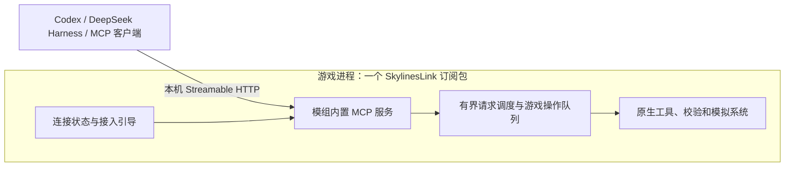

# SkylinesLink 语言与架构调研

调研日期：2026-10-30。状态：建议方案，尚未开始产品实现或游戏内联调。

## 推荐结论

以 **C# 为核心语言，单个模组内置 MCP 服务**：沿用官方工具链当前的 C# 9 / .NET Framework 4.8 目标，在游戏进程内提供本机 Streamable HTTP 连接。需要自定义面板时再采用 TypeScript，构建后的界面资源随模组分发。

维护者明确要求订阅安装即可使用，不额外安装组件。因此普通玩家不需要下载独立 Host，也不需要安装 Node.js、Python、.NET、桥接插件或开发工具。首次在已有 AI 客户端添加 MCP 地址及必要的连接授权仍是正常接入步骤，应尽可能简化。当前这一体验是必须实现的要求，尚非实测结果。

语言不能直接保证客户端兼容。兼容性由协议版本、传输、工具 schema、结果表达、操作状态和实测共同决定。先比较和验证这套方案，不因语言选择直接宣称完整兼容。

## 已核实的依据

### 游戏内运行时

- 当前本机游戏随附的 `Content/Game/.ModdingToolchain/Mod.props` 明确设置 `TargetFramework=net48`、`LangVersion=9.0`。
- 官方模板包 `ColossalOrder.ModTemplate.1.0.0.nupkg` 标明语言 C#，引用游戏、Unity 和 Colossal 程序集，游戏依赖设置为不复制到输出目录。
- 对当前 `Game.dll` 的 `Game.Modding.IMod` 定向读取确认了模组加载/释放接口；未导出或收录游戏反编译源码。
- 游戏携带 `@colossalorder/create-csii-ui-mod` 工具，界面层需按其实际模板选择。当前无需为 MCP 接入先建立复杂界面。

这些是安装文件和元数据检查，不是新模组已编译、加载或运行的证明。不能把现代 .NET 服务程序集加载进游戏来替代官方运行时目标。当前游戏包含 Newtonsoft.Json 和 System.Memory 等库，但不能据此认定新的 SDK 依赖可直接并存。

### MCP 与客户端

- [MCP 官方 SDK 列表](https://modelcontextprotocol.io/docs/sdk)当前将 C#、TypeScript、Python、Go、Rust 等列为 Tier 1。不能以“只有 TypeScript 是一等支持”为选型依据。
- [C# SDK](https://github.com/modelcontextprotocol/csharp-sdk)提供 Core、常规托管和 ASP.NET Core 包。调研时最新稳定发布为 [v2.3.0](https://github.com/modelcontextprotocol/csharp-sdk/releases/tag/v2.3.0)。
- [C# Core v2.3.0 项目](https://github.com/modelcontextprotocol/csharp-sdk/blob/v2.3.0/src/ModelContextProtocol.Core/ModelContextProtocol.Core.csproj)包含 netstandard2.0 目标，但依赖 JSON、Channels、Pipelines、BCL 兼容包等；[ASP.NET Core 托管包](https://github.com/modelcontextprotocol/csharp-sdk/blob/v2.3.0/src/ModelContextProtocol.AspNetCore/ModelContextProtocol.AspNetCore.csproj)仅目标 net8/9/10，不能直接用于 net48 模组。Core 可编译不等于完整 HTTP 服务已可在游戏中运行。
- [TypeScript SDK](https://github.com/modelcontextprotocol/typescript-sdk)当前稳定线为 v2，使用拆分的 `@modelcontextprotocol/server` / `client`；不应依据旧 v1 包名直接搭建新项目。
- 本机 Codex CLI 为 `0.166.0-alpha.5.1`，其 `mcp add --help` 与[官方配置文档](https://learn.chatgpt.com/docs/extend/mcp?surface=cli)均提供 stdio 和 Streamable HTTP 接入。
- 本机 DeepSeek Harness 桌面版为 `0.2.1-rc.5`；只读检查安装包确认其 MCP client 为同版本，使用 `@modelcontextprotocol/client=2.2.0`。
- 本机 DSH 的打包代码和[官方包说明](https://github.com/deepseek-ai/deepseek-harness/blob/master/packages/mcp/mcp-client/README.md)均表明支持这两种传输，并会拒绝要求 task-based execution 扩展的工具。图片还取决于模型与宿主的图像能力。

因此，长操作不能仅靠声明 MCP Tasks 为必需能力。应提供普通工具可调用的操作查询机制，再按能力协商增加可选协议扩展。普通文本与结构化结果应能表达核心信息，图片是补充能力。

[Streamable HTTP 规范](https://modelcontextprotocol.io/specification/2026-07-28/basic/transports/streamable-http)在 2026-07-28 有协议行为变化；不能把不同版本的初始化、会话、流与取消规则混用。实现必须声明支持范围，并使用实际客户端验证兼容协商。规范要求校验 Origin，并建议本机绑定及认证，这些须进入模组内服务设计。

### 交付环境

本机已有 .NET SDK 10.0.403 和 Node.js 24.21.0；未安装或升级工具链。这些属于开发环境，不能成为玩家安装要求。模组只使用游戏实际支持的运行时和随包分发且许可允许的兼容依赖。发行渠道与上传工具详见[发布调研](2026-10-30-distribution.md)。

## 方案比较

| 方案 | 优点 | 代价与适用判断 |
|---|---|---|
| C# 模组内置 MCP | 单订阅包，直接使用游戏运行时；无需额外程序；推荐方向 | 需要验证 SDK 依赖、HTTP 实现、并发及游戏稳定性 |
| C# 模组 + 独立 C# 服务 | 官方 SDK 与现代 HTTP 托管方便；进程故障隔离 | 要求玩家另下载或安装 Host 不符合需求，不能作为默认交付 |
| C# 模组 + TypeScript / Python 服务 | SDK 与各自生态成熟 | 额外运行环境与启动链不符合当前安装目标 |
| 随包附带独立原生或自包含进程 | 理论上可免另装运行时 | 仍有外部进程、平台许可及启动维护问题；尚未证实必要，不作为首选 |

C# 的依据是游戏侧运行时和单订阅交付约束，不是语言天然更兼容 AI。优先验证官方 Core SDK 加兼容的嵌入式 HTTP 适配；如果依赖无法可靠运行，则在相同协议验收下比较更小的原创协议实现。不能以更换实现为由降低标准，也不能默默退回要求玩家安装独立服务的方案。

## 建议的职责边界

- 模组内分别组织协议、契约、游戏执行和连接界面职责，无需为了职责分离额外启动一个服务程序。
- 网络工作不直接从任意线程操作 ECS；通过适用游戏线程调度，用普通值快照返回，限制并发、队列和响应大小。
- 服务随模组加载和释放；端口冲突或网络错误应可见且可恢复，不阻止正常游戏，不要求玩家手工配置系统 URL ACL 或关闭安全软件。
- 默认本机访问；云端专用或只支持 stdio 的客户端仍须单独解决可达性/接入方式，不能宣称已覆盖。可选兼容方案不得成为 Codex、DSH 或其他 HTTP 客户端的必装组件。
- 多客户端可以读取，但游戏写操作需要唯一执行队列。取消等待不等于撤销已提交的原生操作。

## 进入实现前的具体验证

1. 用官方模板构建最小只读模组，确认 net48 / C# 9 与安装版本一致；实际检验 Core SDK 的完整依赖和冲突。
2. 在游戏运行时验证嵌入式 Streamable HTTP、协议版本、工具发现和结果；以普通用户权限检查监听、认证、Origin 及卸载释放。
3. 在 Codex 与 DSH 实测结构化结果、错误、图像拒绝与支持、超时、断开和恢复，并提供接入引导。
4. 核对线程调度、负载上界、帧时间及端口冲突，排除网络请求拖住模拟或留下后台资源。
5. 用同一操作 ID 验证超时后查询、取消边界以及不会重复施工；先用模拟执行器，实际游戏写入另行授权。
6. 在只有游戏和 AI 客户端的 Windows 环境通过 Paradox Mods 订阅验证完整流程，禁止借用开发机已安装的额外运行时掩盖依赖。

上述均尚未完成，不能把文档或 SDK 级别当成集成验收结果。后续任务以同一 OpenSpec change 为准。
