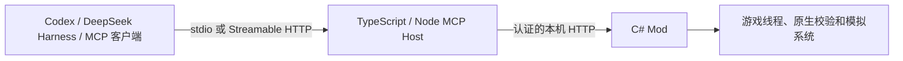

# SkylinesLink 语言与架构决定

核实日期：2026-10-30。架构与语言已确定，产品实现、平台分发和真实客户端验收尚未完成。本记录替代此前游戏进程内置完整 MCP 的建议。

## 已确定的分工

采用 **C# 游戏模组 + TypeScript/Node.js MCP Host**，两部分通过经过认证的本机 HTTP 通信。MCP 使用官方 TypeScript SDK，向客户端同时提供 stdio 和 Streamable HTTP。C# 侧是游戏身份、原生校验、操作事实与写入队列的唯一权威；Host 负责协议、工具输入输出及客户端能力适配。

同一个 Paradox Mods 订阅包包含 Mod、构建后的 Host、官方可移植 Node 运行时和必要许可证。玩家不需要额外安装 Node、.NET、Host、桥接工具或包管理器。首次在 AI 客户端添加 MCP 连接仍是必要的接入配置。随包运行时是否获平台接受、真实订阅是否完整交付，必须在首发前验证，不能把架构决定当成已实现的安装体验。

语言本身不保证兼容或性能。协议版本、工具契约、长操作状态、错误和实际测试决定兼容性；游戏与所有 Host 的资源总量决定运行成本。

## 选择依据

### 游戏侧使用 C#，遵守官方运行时

本机随游戏提供的 `Content/Game/.ModdingToolchain/Mod.props` 明确设置 `TargetFramework=net48`、`LangVersion=9.0`。官方 C# 模板引用游戏、Unity 和 Colossal 程序集，游戏依赖不复制到发行目录。对 `Game.Modding.IMod` 的定向检查确认了加载与释放入口，没有将游戏反编译源码导出到本项目。

开发机使用最新稳定 .NET SDK，但游戏模组保持官方支持的目标和语言级别。新的编译器不代表游戏、Burst 或后处理器支持全部新语法与运行时特性。不能直接将面向现代 .NET 的服务程序集加载进游戏。

游戏随附 UI 模组工具，未来有实际面板需求时再使用其官方模板；首次 MCP 原型无需先建立大型界面。

### MCP 侧使用 TypeScript 和 Node

[MCP 官方 SDK 列表](https://modelcontextprotocol.io/docs/sdk)包含多种一等支持语言，选择 TypeScript 并不是因为其他语言不受官方支持。[官方 TypeScript SDK](https://github.com/modelcontextprotocol/typescript-sdk)当前稳定线为 v2，拆分 server、client 与适配包，支持 stdio 和 Streamable HTTP。独立 Host 允许使用其当前稳定版本，协议测试也可以脱离游戏运行。

曾评估 C# SDK：其 Core 包可包含 netstandard2.0 目标，但完整依赖和 HTTP 托管仍需解决游戏运行时兼容；ASP.NET Core 托管不能直接用于 net48 模组。当前选择不再把完整 MCP SDK 或自行维护的第二套 MCP 实现放进游戏。

Node 选最新 LTS 系列和稳定补丁，TypeScript、pnpm 及依赖采用最新稳定版并固定。精确版本、来源与本机安装状态统一见[开发工具与版本基线](../development/toolchain.md)。pnpm 为主要包管理器，npm 仅备用；TypeScript 是项目开发依赖，无需全局安装。严格类型检查和构建在开发阶段完成，玩家只收到 JS 和随包运行时。

默认打包采用官方可移植 Node + JS bundle。[Node SEA](https://nodejs.org/api/single-executable-applications.html)仍标注 Active development，可另行评估，但不作为首发依赖。单次订阅可以交付多个文件，无需为单一可执行文件增加不必要的构建约束。

### 客户端与协议依据

- 本机 Codex CLI `0.166.0-alpha.5.1` 的命令帮助支持 stdio 与 Streamable HTTP；[官方配置说明](https://learn.chatgpt.com/docs/extend/mcp?surface=cli)提供相应入口。
- 本机 DeepSeek Harness `0.2.1-rc.5` 的安装代码使用 MCP client `2.2.0`，支持这两种传输，并拒绝要求 task-based execution 扩展的工具；[官方客户端包说明](https://github.com/deepseek-ai/deepseek-harness/blob/master/packages/mcp/mcp-client/README.md)提供能力依据。这些是现有验收客户端版本，不是要求项目采用预发布依赖。
- [stdio 规范](https://modelcontextprotocol.io/specification/2026-07-28/basic/transports/stdio)由客户端管理子进程，stdout 仅承载协议，日志写 stderr。
- [Streamable HTTP 规范](https://modelcontextprotocol.io/specification/2026-07-28/basic/transports/streamable-http)包含版本、来源和连接行为要求；不能混用不同版本的语义，也不能只验证 SDK 示例就宣称所有客户端兼容。

因此，核心长操作以普通工具提交、查询和稳定操作 ID 表达，Tasks 作为可选扩展；核心结果保留文本与结构化数据，图像按宿主和模型能力提供。云端专用客户端访问本机的问题需要单独实现，不能由本地两种传输直接推导出全覆盖。

## 运行和维护边界

- stdio Host 由 AI 客户端启动和释放；多个客户端可以各自持有 Host，但所有游戏写入仍进入 C# 的同一队列。
- HTTP Host 由模组按需启用并管理。模组释放时只停止自己的 HTTP Host 与内部监听，不误杀客户端持有的 stdio 进程；后者可明确返回游戏不可用，直到客户端关闭它。
- 模组从已经订阅且核验过的文件自动准备稳定用户数据入口，避免 AI 配置指向随更新变化的市场缓存目录。无额外下载或安装脚本，版本切换处理在用文件和组件匹配。
- 内部契约以单一版本化 schema 为权威，派生或校验 C# / TS 类型并验证序列化。只交换普通值、快照和稳定引用，不传递游戏原生对象。
- HTTP 默认仅本机监听，验证 Origin 和授权，凭据不放在命令行或日志。网络线程不直接操作 ECS，所有游戏访问经适用线程、有界调度和身份校验。
- 游戏侧完成查询范围限制、聚合和分页，不将全城数据搬到 Node 后筛选；没有请求时不持续全城扫描。性能测试涵盖全部进程、多个客户端与过载场景。

模块、生命周期、错误和发布顺序以 [OpenSpec design](../../openspec/changes/establish-project-foundation/design.md) 为权威；后续工作统一维护在 [tasks](../../openspec/changes/establish-project-foundation/tasks.md)。

## 需验证的关键条件

1. 官方模板构建与游戏加载，C# 本机接口在普通用户权限下的监听、线程与释放行为。
2. 脱离游戏的 TS Host 双传输、协议协商、契约一致性与明确错误。
3. 多客户端、Host 重启、游戏切换及超时后的操作查询，不盲目重复施工。
4. Codex 与 DSH 两种传输的真实接入、能力差异及断线恢复。
5. 全部进程资源、游戏线程耗时和延迟的可复现测量，再据此设置性能预算。
6. 平台规则、完整订阅包、稳定连接入口、更新与退出，在无开发工具的玩家环境验收。

这些尚未完成。选择两种语言的代价是随包运行时、跨语言契约和进程管理；必须通过上述验证兑现维护性、免安装和低占用要求。发布渠道与同步流程见[发布调研](2026-10-30-distribution.md)。
