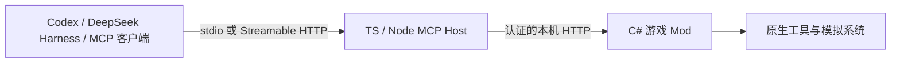

# Design

## Context

动机和范围见 [proposal.md](proposal.md)。项目当前只有说明、调研与 OpenSpec，无产品代码或运行服务。

已确定 C# Mod + TypeScript/Node.js MCP Host。官方模组模板当前设置 C# 9 / net48；现代 MCP SDK 在独立 Node 进程中运行。Codex 和 DSH 均提供 stdio、Streamable HTTP；本机 DSH 明确拒绝必需的 Tasks 扩展。依据见[选型记录](../../../docs/research/2026-10-30-language-selection.md)，工具基线见[toolchain](../../../docs/development/toolchain.md)。

## Goals / Non-Goals

**Goals:**

- 落实 C# 游戏执行与 TS/Node 协议适配分工，满足单订阅安装要求。
- 让协议兼容、游戏执行和发布验证分别可观察。
- 保持核心规则的一处权威，并以同一版本和制品驱动两个发布渠道。

**Non-Goals:**

- 本轮不实现或加载模组，不定义全部城市工具清单，不声称客户端集成已验证。
- 不构建新的 AI 客户端，不托管模型账号或推理服务。
- 不将云端远程接入、全量图形界面或自动化城市建设列入首个连接原型。

## Decisions

### 1. C# Mod 与 TS/Node Host 分进程，单订阅交付

C# Mod 按官方游戏目标构建，负责身份、原生校验、游戏线程执行和操作事实。TypeScript/Node Host 使用官方 TS SDK，负责 MCP 工具、协议、客户端差异和结果投影。两部分通过经过认证的 loopback HTTP 通信，只有 C# 侧能够执行游戏操作。

同一订阅包携带 Mod、已构建的 Host 和官方可移植 Node 运行时及必要许可证。玩家不安装 Node、.NET、npm、桥接工具或开发环境，不执行安装脚本、不手工复制文件。默认使用随包运行时和 JS bundle；单可执行文件 SEA 可以后续评估，不把仍标注 Active development 的打包特性作为首发前提。

选择分进程是为了让 MCP SDK 独立于游戏运行时，并允许协议层脱离游戏测试和更新；代价是运行时体积、跨语言契约和进程生命周期。全 C# 进程内 MCP 不再是默认方案。组件分进程不改变“订阅一次即可获得全部所需文件”的要求。

### 2. 分离传输、工具契约和游戏执行

Host 同时提供 stdio 和 Streamable HTTP，复用同一套工具处理器。C# 本机 HTTP 是内部游戏能力接口，不承担第二套 MCP 协议。请求经过游戏身份及资格校验，通过有界调度进入适用游戏线程；真实城市身份、原生操作状态和写队列均由 C# 侧统一拥有。

游戏接口和 Host 的 HTTP 监听默认仅绑定本机，校验 Origin 与访问授权；不同进程之间通过受控本地发现信息确定实例、端点和凭据，凭据不出现在命令行、公开配置或日志中。监听方案须验证普通用户权限，不依赖手工 URL ACL、管理员权限或关闭安全软件。

stdio Host 由 AI 客户端启动，日志写 stderr，stdout 只承载 MCP。多个客户端可能各持有一个 Host，不能把各 Host 都变成游戏写入权威。客户端关闭或结束探测后，对应进程应正常退出；游戏未运行时返回明确状态，不擅自启动游戏或反复重试写操作。

Streamable HTTP 模式由模组连接设置按需启用并管理一个共享 Host，记录明确的进程归属，停止时仅结束本次拥有的实例。stdio 与 HTTP 可以并存，共用 C# 单一操作队列。模组释放时关闭内部监听和自有 HTTP Host；由 AI 客户端持有的 stdio Host 可以继续响应“游戏不可用”，直到其所有者关闭连接，不能误杀其他客户端进程。

模组首次启用后自动准备受控用户数据目录中的稳定连接入口及版本化文件，来源仅限已订阅包中核验过的内容，不在线下载运行代码、不启动安装器。客户端配置不直接绑定可能变化的市场缓存版本目录。更新处理在用文件与版本切换，失败时保留可识别状态；不能混用不同发行版的 Mod、Host、运行时和契约。

连接入口提供当前可用命令/地址与必要授权，用户只需首次添加 MCP 连接。云端专用客户端的本机可达性仍需单独实现，不能宣称本地两种传输就已覆盖全部部署形态。

### 3. 长操作以业务操作状态为基础

普通工具提供提交和查询，返回稳定操作 ID。MCP Tasks 可作为后续可选适配，不能成为基线客户端的硬要求。取消请求要区分取消等待、取消尚未执行的工作和已经进入原生提交；查询不到事实时返回未知。

需要在 Host 重启、客户端重连、游戏世界切换和重复请求下验证操作归属与状态保留。Host 只投影游戏端操作状态，不拥有会随进程退出丢失的独立施工账。超时后先用原操作 ID 查事实；协议版本的取消语义与游戏操作取消分别处理。

### 4. 独立发布与 MPL-2.0

维护者已选择 MPL-2.0。游戏程序集、反编译内容和本机资料不进公开版本。项目原创内容、第三方依赖声明及品牌说明分开维护；GitHub 源码和 Paradox 模组制品分别检查，平台授予的权利另按当时条款核对。

Paradox Mods 提供完整订阅包，GitHub 发布源码及同版包。以只有游戏和 AI 客户端的 Windows 环境验收，显式使用包内 Node，不借用开发机运行时掩盖依赖。携带运行时意味着需要随包提供对应许可证并维护安全更新。平台是否接受和正确交付这些文件必须真实验证，不能把上传器会收集文件当成平台已经批准。依据见[发布调研](../../../docs/research/2026-10-30-distribution.md)。

### 5. 所有上传材料先脱敏

执行[公开材料与脱敏规则](../../../docs/governance/publication-privacy.md)，检查实际暂存内容和待推送历史，并使用 GitHub 隐私邮箱提交。本机研究证据和助手配置只在仓库私有忽略目录保存。发行时另查压缩包、日志、截图、符号文件及嵌入路径，不能以源码扫描结果替代附件检查。保留合法公开的项目身份和必要的版权归属，不上传凭据的部分原值。

### 6. 两渠道同版且可恢复发布

一次发布锁定版本、提交、更新日志和模组文件清单。先准备 GitHub Release 草稿与审核后的附件，再通过官方 ModPublisher 发布 Paradox Mods 对应版本，核实后完成 GitHub 发布并回读两端事实。初次创建保存 ModId，后续使用 NewVersion；Update 只用于页面元数据。

维护每个渠道的远端标识和已知状态。失败后先查事实再继续缺失步骤，不重复创建条目、不覆盖同版不同内容。平台没有共同事务，同步表示同版及一次可恢复流程，不保证瞬间同时可见。默认在合法安装游戏工具链的受控 Windows 发布环境执行；后续可接 GitHub Actions，但当前不安装 runner、不配置凭据。

### 7. 模块边界与跨语言契约

使用一个仓库和一个发行版本管理两个组件，按职责划分模块。依赖保持单向，游戏类型不进入 TS 代码，MCP SDK 不加载进游戏。

| 模块职责 | 拥有的事实与行为 | 依赖边界 |
|---|---|---|
| Contracts | 版本化请求/响应 schema、错误、分页、身份与操作标识 | 中立的协议描述，生成或校验两端类型，不依赖游戏或 MCP SDK |
| C# GameApplication | 原生资格、操作状态与唯一执行队列 | 使用 Contracts，调用游戏适配层 |
| C# GameIntegration | ECS 查询、原生工具、游戏线程及加载身份 | 隔离游戏程序集与原生对象 |
| TS GameClient | 本机发现、认证、HTTP 调用与错误映射 | 消费 Contracts，不复制游戏规则、不盲目重试写请求 |
| TS Mcp | 工具定义、协议版本、stdio/HTTP 与结果表达 | 复用 GameClient；两种传输共用工具处理器 |
| Mod Composition / Connection | 模组生命周期、连接引导、自有 HTTP Host 管理与随包文件入口 | 组装组件；不另建业务规则或写入队列 |

依赖保持单向，禁止协议层和界面层绕过应用接口直接施工。工具通过明确的注册与输入/输出契约扩展，复用统一错误、分页及操作生命周期；新增工具不修改 HTTP 核心或另建第二套执行队列。不为未确认需求先搭通用插件运行时、脚本执行器、微服务或重型基础设施。

内部契约以一份版本化 schema 为权威，派生两端类型并验证实际序列化；连接时检查契约与组件版本。不维护相互独立的两套 DTO 规则，也不暴露任意反射或代码执行接口。跨语言只传普通值、必要快照和稳定引用。

开发与依赖采用最新 LTS / 稳定版，按[版本基线](../../../docs/development/toolchain.md)固定精确版本和锁文件，更新后验证。项目安装、脚本和 CI 统一使用 pnpm，npm 只作备用，不混用依赖锁文件。TypeScript 安装为项目开发依赖以完成类型检查和构建，无需全局安装；玩家收到构建后的 JS 及运行时，不需要 TypeScript 编译器。C# 使用最新稳定 SDK 编译，游戏目标遵循官方支持范围。

### 8. 低占用与性能证据

默认按请求读取，不持续全城轮询、导出或预加载全部资产。通过有范围的查询、分页和必要快照控制工作量；只有测量证明重复读取成本显著时才引入缓存，并绑定城市/加载周期、标注新鲜度且明确失效条件。客户端看到的是带身份和完整性信息的事实，不以过时缓存换取表面速度。

限制请求体、并发、执行队列、结果量和每次游戏线程工作；大操作拆成可追踪的有界工作单元。需要大量遍历的游戏查询在 C# 侧按范围执行、聚合和分页，不把全城数据搬到 Node 后再筛选。Node 不执行游戏模拟，避免大体积同步 JSON 与 CPU 工作阻塞事件循环。序列化使用普通值快照，不在后台持有可失效的游戏原生对象。缓存、对象池和底层优化以剖析结果决定。

性能对比必须使用相同游戏版本、存档、画质、模拟速度和可复现负载，记录无模组基线、仅 Mod 空闲、单 Host、多客户端、正常读取、连续操作及过载场景。统计游戏和全部 Host 的 CPU/内存合计及分项、分配与 GC、游戏线程/帧耗时的 P95/P99、事件循环延迟、请求耗时、传输体积和队列深度；渲染帧率不替代模拟吞吐。先取得原型基线，再确定并执行预算，不以只测单个进程掩盖总占用。

诊断默认低噪声、可关闭且不包含敏感值，不能为了观测性能反而持续制造大日志或完整快照。异常路径必须释放流、缓冲与监听资源。

## Risks / Trade-offs

- Node 运行时、多个 Host 与跨进程序列化增加占用 → 按需启动、限制返回规模，统计所有进程资源并执行性能预算。
- 跨语言契约漂移 → 单一 schema、生成/校验类型、版本握手和两端序列化测试。
- 客户端探测或更新导致重复进程、路径失效 → 明确 stdio/HTTP 所有者、稳定入口、在用文件更新和清理验证。
- 协议与 SDK 继续变化 → 固定发行版本与契约，记录客户端/协议实测矩阵，避免仅跟随最新版本号。
- 客户端能力差异 → 文本和结构化结果构成核心；图像、Tasks 等按能力提供。
- 原生操作与网络生命周期不同步 → 唯一操作标识、明确执行阶段、重连查询及重复提交验证。
- 单订阅包遗漏运行依赖 → 在无开发工具环境完成真实订阅验收，检查实际发行内容。
- 平台对随包运行时的接受情况尚未验证 → 在首发前验证官方规则及真实上传，不宣称“订阅即用”已经实现。
- 两渠道部分成功 → 记录远端事实，失败后继续缺失步骤，不以盲目重试实现同步。
- 平台许可和源码许可的权利范围不同 → 发布前检查当时条款及实际制品，不承诺开源许可证能替代平台授权。

## Migration Plan

这是新项目，无既有代码或用户数据需要迁移。实施顺序为工具链与契约、离线 TS MCP、C# 只读接口、两组件生命周期、故障恢复、客户端及单订阅验收、同步发布；写操作和正式模组发布另按明确范围实施。更新以同一版本切换组件，保留可核对的运行状态；已发布版本需要修复时发布新版本，不删除重建条目或替换同版内容。
